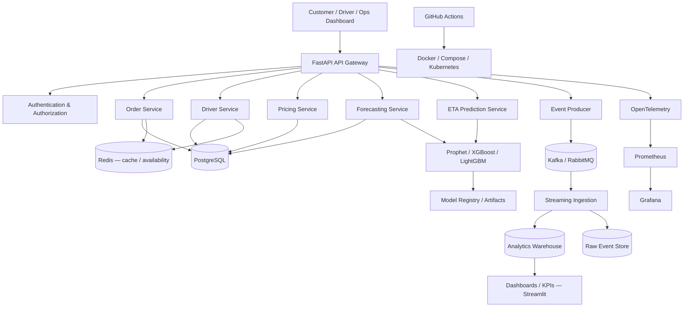

# Architecture

## Target architecture (full roadmap)



## Phase 1 — what is implemented today

A **modular monolith** with clean internal boundaries, so each service can be
extracted later without rewriting the domain:

```
apps/api (FastAPI)
   ├── routes/            HTTP layer: validation, status codes, serialization
   ├── schemas/           Pydantic contracts (OpenAPI)
   └── deps.py            DI: database session
domain/
   ├── models/            SQLAlchemy 2.0 entities + order event log
   ├── rules/             pure functions: haversine, pricing tiers, eligibility
   └── services/          use-cases: order lifecycle, dispatch, quote, ETA
core/                     config (env), engine/session, logging, exceptions
```

### Design decisions

- **Rules are pure, services orchestrate.** Pricing/surge and driver eligibility
  are side-effect-free functions — exhaustively unit-testable and trivially
  replaceable when Phase 3 swaps in ML-driven versions.
- **Event log from day one.** Every order mutation appends an `OrderEvent` row.
  This is the raw feed the Phase 2 ingestion pipeline consumes — no retrofit
  needed when the event bus arrives.
- **Database-portable ORM.** SQLAlchemy 2.0 typed models run on SQLite (local,
  zero-config) and PostgreSQL (Docker) unchanged via `DATABASE_URL`.
- **Errors as domain exceptions.** Business rules raise typed exceptions
  (`NotFoundError`, `InvalidTransitionError`, `NoDriverAvailableError`) mapped
  to consistent HTTP error envelopes by one handler.
- **Metrics endpoint early.** `/analytics/metrics` already exposes Prometheus
  text format so observability lands with the product, not after it.
