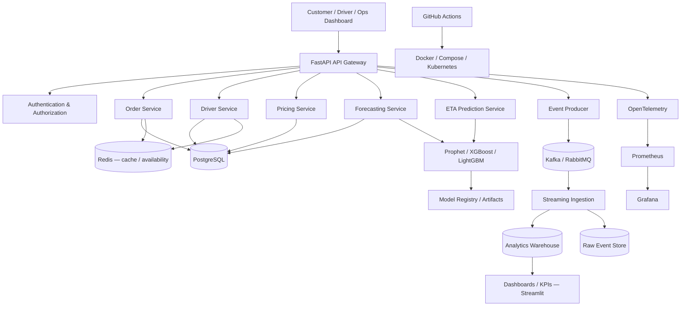

# Architecture

## Target architecture (full roadmap)



## Phase 1 — what is implemented today

A **modular monolith** with clean internal boundaries, so each service can be
extracted later without rewriting the domain:

```
apps/api (FastAPI)
   ├── routes/            HTTP layer: validation, status codes, serialization
   ├── schemas/           Pydantic contracts (OpenAPI)
   └── deps.py            DI: database session
domain/
   ├── models/            SQLAlchemy 2.0 entities + order event log
   ├── rules/             pure functions: haversine, pricing tiers, eligibility
   └── services/          use-cases: order lifecycle, dispatch, quote, ETA
core/                     config (env), engine/session, logging, exceptions
```

### Design decisions

- **Rules are pure, services orchestrate.** Pricing/surge and driver eligibility
  are side-effect-free functions — exhaustively unit-testable and trivially
  replaceable when Phase 3 swaps in ML-driven versions.
- **Event log from day one.** Every order mutation appends an `OrderEvent` row.
  This is the raw feed the Phase 2 ingestion pipeline consumes — no retrofit
  needed when the event bus arrives.
- **Database-portable ORM.** SQLAlchemy 2.0 typed models run on SQLite (local,
  zero-config) and PostgreSQL (Docker) unchanged via `DATABASE_URL`.
- **Errors as domain exceptions.** Business rules raise typed exceptions
  (`NotFoundError`, `InvalidTransitionError`, `NoDriverAvailableError`) mapped
  to consistent HTTP error envelopes by one handler.
- **Metrics endpoint early.** `/analytics/metrics` already exposes Prometheus
  text format so observability lands with the product, not after it.

## The two geo engines (both read OpenStreetMap — different jobs)

A customer types an address; the platform needs coordinates AND the road
between two points. These are two different computations over the SAME free
OpenStreetMap data, done by two different engines:

```
"Calle Gran Vía 42, Madrid"
        │
        ▼
   Nominatim (geocoder)          text → coordinates
        │  40.4214, -3.7038
        ▼
   OSRM (routing engine)         coordinates → road path
        │  1757 m, 345 s, turn-by-turn geometry
        ▼
   pricing · ETA · dispatch · route geometry
```

- **Nominatim** searches the map's indexed place and address names:
  *text in, coordinates out*. It cannot route — it has no notion of roads
  between points. Served free via its public API, paced to its ~1 req/s
  fair-use policy, and cached forever in `geocode_cache` (#232).
- **OSRM** precomputes a routable graph from the same OpenStreetMap extract
  (the `osrm-prepare` step builds an MLD partition per city). *Coordinates
  in, road path out*: real road distance, travel time, and the LineString
  geometry stored per order (`GET /orders/{id}/route`). Self-hosted in
  Docker — one deployment = one city's graph. Without it the platform
  falls back to straight-line (haversine) distance, which is exactly the
  champion-vs-shadow comparison the distance migration review reads.

Short version: **Nominatim answers WHERE; OSRM answers HOW FAR and HOW LONG
along real streets.** The geocoder landing did not replace routing — it
removed the need for anyone to know coordinates at all.

## The AI layer (Phase 5)

The copilot is an agent OVER the governed API, not beside it: a LangGraph
supervisor whose five read-only tools call the platform's own services with the
request's session — Row-Level Security scopes every answer to the caller's
tenant by construction. A pgvector store (RAG over the runbook + decision
records), guardrails, tool/token budgets, a flagship→mini fallback chain with
`degraded_reason` in the payload, MLflow tracing per conversation, an incident
narrator on the alert path, and a golden-set eval harness enforced in CI.
Full map — shipped vs. next — lives in [ai.md](ai.md).
