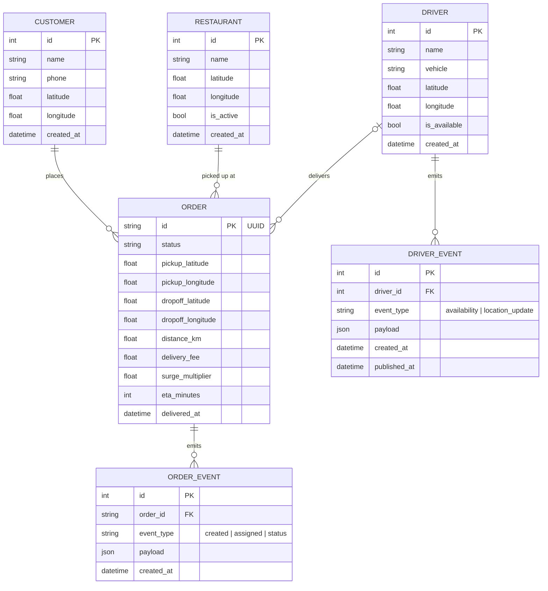
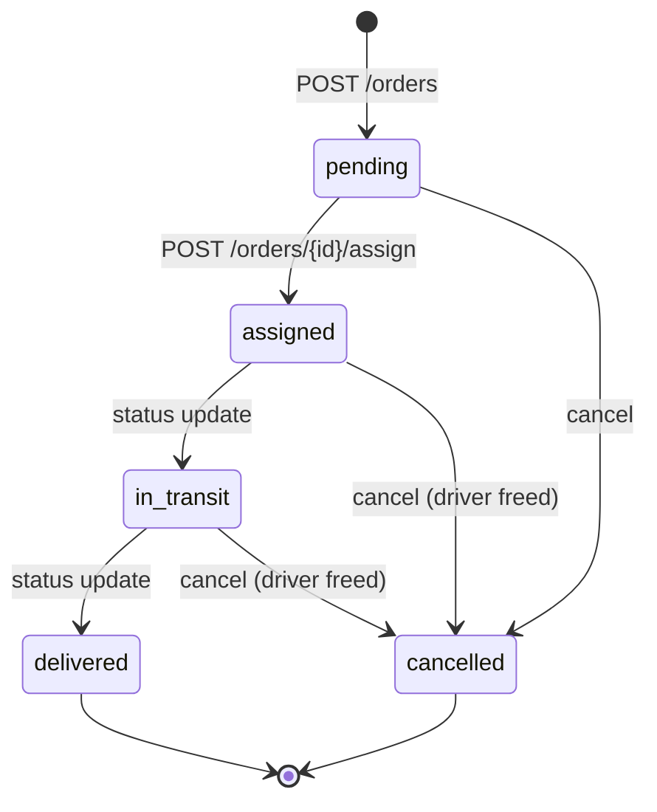

# Data Model

## Entity relationship

## Tenancy (#35)

Every business row carries `tenant_id` → `tenants` (id, slug, name, city).
Today one tenant exists (`default`, inserted by migration 002 and
backfilled onto all rows); the resolution point is
`domain/services/tenant_service.py` — a single function the isolation
layer (#36) will replace with JWT-claim resolution. Event payloads carry
`tenant_id` too (the envelope), so the warehouse's raw layer inherits the
dimension as-received. Deliberately tenant-agnostic for now: `users`
(binding arrives with #36's claims), `route_cache` and `demand_forecasts`
(deployment-level aggregates).

## Order lifecycle

Notes:

- `assigned` can only be reached through the dispatch endpoint — the status
  schema rejects it on `POST /orders/{id}/status`.
- Driver availability is a transactional side-effect: assigning marks the
  driver busy; delivery or cancellation frees them.
- Each availability change is also committed to the driver outbox in the same
  transaction. The warehouse reconstructs hourly available supply from those
  events; continuous GPS pings remain out of scope.
- Pickup coordinates are **snapshotted** at creation so later restaurant
  edits never mutate historical orders.
- Phase 2+ warehouse marts (`analytics.*`: daily order summary, demand by
  zone-hour, driver utilization, driver supply, demand vs supply, pricing
  history, demand timeseries) derive from the raw event streams via dbt.
  Demand forecasts land in the OPS database (`demand_forecasts`), written by
  the serving job — the API has no warehouse connection.
