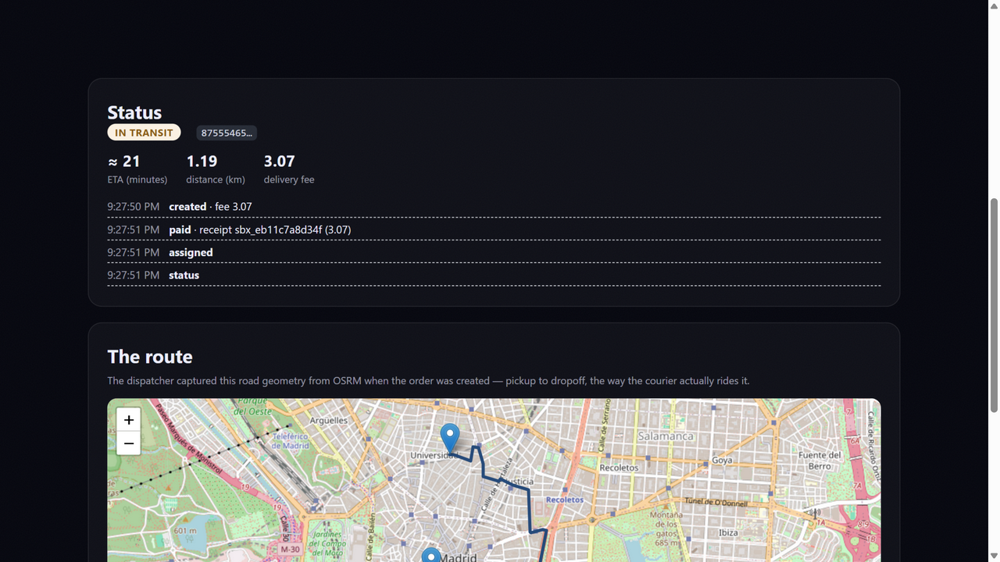
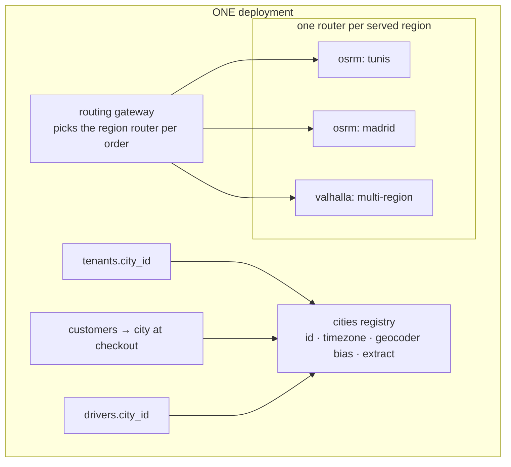
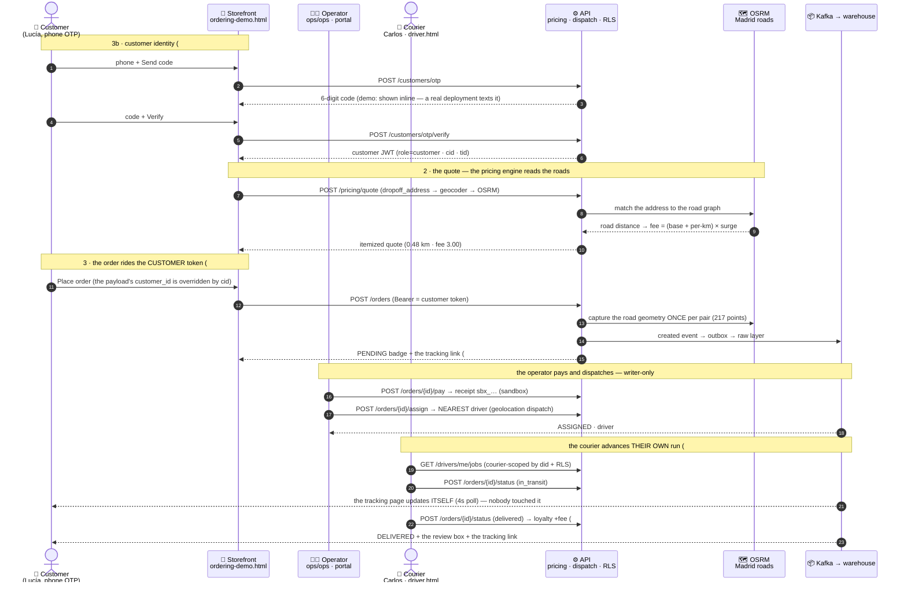
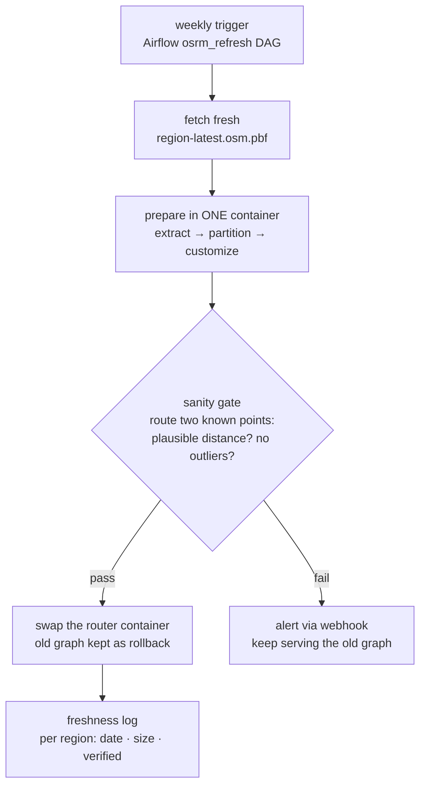
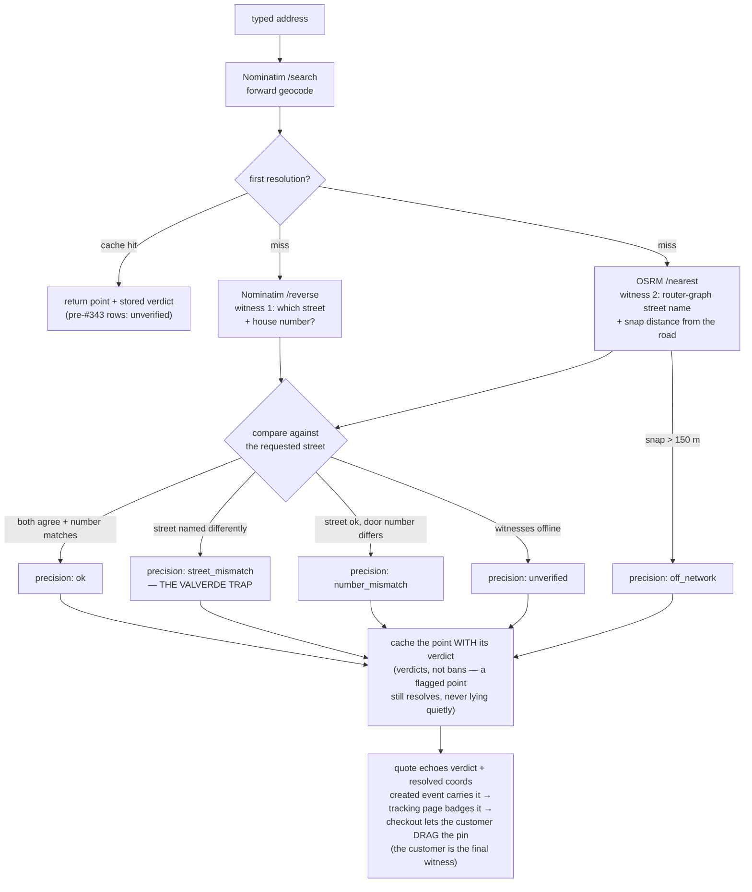
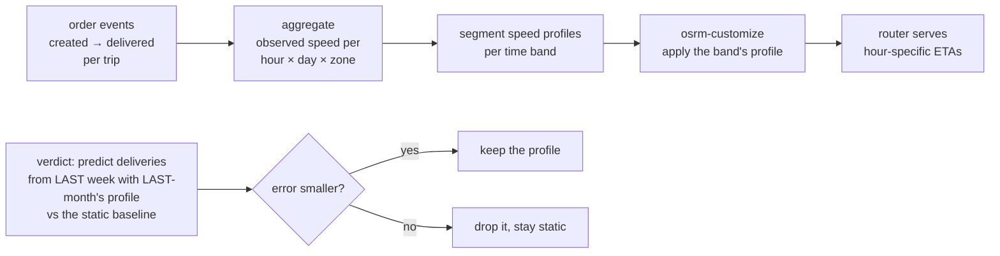

# Self-hosting the maps under a delivery platform: OSRM, the 26 files, and multi-city routing

*How Smart Delivery Ops replaced a per-request commercial routing bill with
its own road graph, served three cities from one codebase, and what we
learned operating it — including the failure that made OSRM route
5,569 km for a 1.19 km trip.*

This is the guide we wished existed when we wired our delivery platform's
maps. It covers the prerequisites (what Geofabrik is, what each OSRM file
in the prepared graph actually is), the prepare pipeline, the
multi-city architecture, data freshness automation, time-aware ETAs, and
the low-emission-zone rules that decide which courier rides which street.

---

## 0 · Why a delivery platform needs its own routing engine

A delivery platform asks the map two questions thousands of times a day:

1. *"How far, by road, from this kitchen to this customer?"* — at quote time
2. *"How long did the ride actually take?"* — for ETAs, dispatch, and proof

The commercial answer bills per request. Published benchmarks put Google's
Directions/Routes API at **$5–30 per 1,000 requests**; a dispatch workload
(constant quotes, matrices, re-routing) at scale has published case studies
of **$8,000/month** on Google replaced by **~$520/month self-hosting OSRM**
— with response times *faster* than the commercial API in production
(see the r/selfhosted case study linked at the end).

The economics for a platform with an in-house fleet are one-sided:

| | commercial routing API | self-hosted OSRM |
|---|---|---|
| cost shape | per request, forever | a server (~$50/month per region), no meter |
| rate limits | yes, and they bill past them | none |
| data ownership | theirs | yours |
| traffic quality | live traffic included | static speeds (see §9) |
| edge cases | mature | OpenStreetMap-quality, self-maintained |

OSRM is genuinely production-grade — the same engine class that powers
hosted services — and the honest gaps have workarounds this guide covers.

## 1 · Prerequisites: the four nouns

### OpenStreetMap (OSM)
The free, community-built map of the world. Every road, with attributes
(speed limits, access rules, surface). License: **ODbL** — free to use,
**attribution required** (ship "© OpenStreetMap contributors" in any map
UI; our tracking page carries it).

### Geofabrik
The company that publishes **ready-made regional extracts** of OSM —
`https://download.geofabrik.de/europe/spain/madrid-latest.osm.pbf` — the
`-latest` files refresh **daily**. This is the raw material: a binary
snapshot of every road in a region. Free, daily, per region.

### OSRM (Open Source Routing Machine)
The C++ engine that turns that snapshot into a routable graph and serves
`/route`, `/table` (distance matrices), and matching over HTTP. Millisecond
routes, no meter, no limits. Also the engine class behind several hosted
routing services.

### Docker
Everything below runs in the official `ghcr.io/project-osrm/osrm-backend`
image. No OS-specific builds.

## 2 · The file family: what the 26 files actually are

This is the part every tutorial skips. `osrm-extract` does **not** produce
one file — it produces a **family of files sharing one base name** (the
"siblings"). Together they are the road graph; each sibling answers a
different question.

You can find them on any Smart Delivery Ops checkout:

```bash
ls data/osrm/madrid/
# madrid-latest.osm.pbf               ← the raw map snapshot (input)
# madrid-latest.osrm.geometry         ← the road shapes (coordinates)
# madrid-latest.osrm.edges            ← the graph: which roads connect where
# madrid-latest.osrm.names            ← street names per edge
# madrid-latest.osrm.properties       ← speed/access class per edge
# madrid-latest.osrm.restrictions     ← turn restrictions
# madrid-latest.osrm.timestamp        ← when the data was extracted
# madrid-latest.osrm.partition        ← region bisection for the MLD hierarchy
# madrid-latest.osrm.cells            ← the pre-computed hierarchy cells
# madrid-latest.osrm.cell_metrics     ← per-cell metrics (MLD customization)
# madrid-latest.osrm.cnbg, .cnbg_to_ebg, .mldgr  ← the customized MLD graph
# madrid-latest.osrm.fileIndex, .icd, .enw, .ebg, .ebg_nodes,
# madrid-latest.osrm.nbg_nodes, .ramIndex, .tld, .tls,
# madrid-latest.osrm.turn_duration_penalties, .turn_penalties_index,
# madrid-latest.osrm.datasource_names, .maneuver_overrides
```

The three phases that build them:

| phase | tool | writes |
|---|---|---|
| **extract** | `osrm-extract` | the edge-based graph: `.geometry`, `.edges`, `.names`, `.properties`, `.restrictions`, `.timestamp`, … |
| **partition** | `osrm-partition` | the MLD hierarchy: `.partition`, `.cells`, `.cnbg`, `.cnbg_to_ebg`, `.cell_metrics` |
| **customize** | `osrm-customize` | the routing-ready overlay: `.mldgr`, `.ramIndex`, `.tld`, `.tls`, `.turn_*` |

`osrm-routed` opens **the whole family by the shared prefix** — you point
it at `madrid-latest.osrm` and it reads the 26 siblings around it. Our
first debugging dead-end: we hunted a "missing base file" that the
*working* city also doesn't carry as a standalone host file — the family
by prefix is what matters, and a family missing **any** member is a
broken graph.

```mermaid
flowchart LR
    A[Geofabrik<br/>region-latest.osm.pbf<br/>raw map, refreshed daily] --> B[osrm-extract<br/>car/bike profile]
    B --> C[edge-based graph<br/>geometry · edges · names · properties]
    C --> D[osrm-partition<br/>bisection into cells]
    D --> E[MLD hierarchy<br/>partition · cells · cnbg]
    E --> F[osrm-customize<br/>apply speeds per cell]
    F --> G[routing-ready overlay<br/>mldgr · ramIndex · tld · turn_*]
    G --> H[osrm-routed<br/>GET /route · /table · /match]
    style A fill:#e8ebf0
    style H fill:#e7f6ec
```



**The rule we learned the hard way: build the family in ONE container
session.** A family stitched from files of different prepare generations
is a corrupted graph — ours faithfully routed **5,569 km for a 1.19 km
trip**. If your route distances are absurd, check the file timestamps
first: a family must share one build.

## 3 · The multi-city architecture: one deployment, many cities

A delivery platform's map region is a **platform decision**: you choose
which cities the business operates in. A restaurant client joins a served
city (onboarding registers their kitchen into its coverage); a driver
belongs to a city's fleet; a customer's address resolves inside it. The
client never picks a map — the map is infrastructure, like the database
engine.

The platform ships **city packs** — one JSON manifest per city plus its
prepared graph:

```json
{
  "city": "madrid", "label": "Madrid",
  "business_timezone": "Europe/Madrid",
  "osrm": { "extract_id": "madrid" },
  "restaurants": [ "…" ],
  "customers": [ "…" ]
}
```

Today: `CITY=madrid` on the deployment flips the whole stack — the seed
loads the manifest, the router serves the Madrid graph, the storefront
shows Madrid restaurants, tracking draws Madrid roads. The live proof
(2026-11-20): a Madrid order placed, paid, dispatched, and tracked with a
**217-point road route through central Madrid** — Universidad to Plaza
Mayor, drawn on the tracking page:



Three packs are staged and proven: **Tunis** (the home pilot), **Madrid**
(the expansion showcase), **Paris** (staged). Any city is one manifest +
one extract away.

The **target architecture** removes the last global knob — `CITY` — and
makes cities a database row:



Every actor is bound to a city; every surface (storefront restaurants,
driver jobs, dispatch) filters by it; the routing gateway picks the region
from the order's coordinates. One router per region is cheap — or Valhalla
serves many regions in **one process** natively (its tile design is
multi-city by construction), which is the engine-level answer to the
per-container question.


## 3b · The full lifecycle, dispatch by dispatch — every actor and every tool

The Madrid live-proof as one sequence: two surfaces (the storefront, the
courier's page), two identities (the customer's OTP token, the operator's
staff token, the courier's driver token), one shared event log.



The two tokens NEVER cross: the customer's can place orders and read
their own history; the staff's can pay, dispatch and transition any
order; the courier's can advance only their own assigned run. The
tracking page needs no token at all — the order id is the capability.

## 4 · Data freshness: a backup nobody restored is a hope, a map nobody updated is a map of the past

Geofabrik refreshes the source **daily**. Your prepared graph only changes
when you rebuild it — and nothing in a stock OSRM deployment rebuilds
anything. Our answer: a scheduled refresh with a **sanity gate before any
swap**:



Cadence: **weekly**. Roads change on weeks-scale; daily prepares burn CPU
for nothing and restart the router daily. Our measured prepare for an
85 MB metro extract: **~4 minutes** in one container. The verification
gate is non-negotiable — it is what catches a corrupted family *before*
it serves (see §5).

## 5 · The war story: 5,569 km for 1.19 km

The sequence that produced our favorite bug, all of it reproducible:

1. Git Bash rewrote `/opt/car.lua` into `C:/Program Files/Git/opt/car.lua`
   inside the container args (the MSYS path-mangling gotcha —
   `MSYS_NO_PATHCONV=1` on every `docker run`).
2. The Windows bind-mount **lost container-created files** in `data/osrm/`
   — 26 siblings persisted, the one file that mattered didn't reach the
   host. Fix: the pipeline runs **without the host mount** — the data lives
   in the container's own layer, committed to an image.
3. Repeated prepare attempts left the router reading a family stitched
   from **different generations** — OSRM returned a region-spanning
   1,399-point route (5,569 km) for a 1.19 km trip.
4. The sanity gate we added afterwards (route two known points, compare
   against the plausible distance) catches this class **before** it serves.

Sound-bite: *a corrupted graph doesn't crash — it lies. The gate exists
because lies need a detector.*

## 5b · The geocoder is guilty until proven innocent (#343)

A week after the 5,569 km war story, the SIBLING bug appeared — same
family, different organ. This time the router was innocent and the
**geocoder** lied. A customer ordered to "Calle de Fuencarral 24, Chueca"
in Madrid; the pin landed **on Calle de Valverde, the parallel street one
block north**. The label said the right street; the coordinates said the
wrong one. The worst part: it was *cached* — geocode_cache stores every
first resolution forever, so the wrong answer would repeat for every
future order to that address.

The diagnosis humbled us twice:

1. **Nominatim's house-number interpolation** resolves "Fuencarral 24" by
   walking the street's number range — and dropped the interpolated door
   on the wrong street. Queried fresh, it returns the identical offset
   point. Upstream, not our stack.
2. **The reverse geocode did NOT catch it.** Reverse-geocode the wrong
   point and Nominatim anchors to a storefront ON Fuencarral — "Calle de
   Fuencarral" comes back, agreeing with the forward result. Two wrongs
   citing each other. A witness anchored to the same data provider is not
   an independent witness.

The witness that caught it lives in our own stack: **OSRM `/nearest`**.
The router graph knows which street a coordinate actually sits on — it
has no POI anchor to be fooled by. Snap "Fuencarral 24"'s wrong point
and OSRM answers: *Calle de Valverde*, 9 m away. The router is already
running; the check costs one request and zero infrastructure.

So every first resolution is now verified before it is cached — two
witnesses, worst verdict wins. **The hierarchy matters and was learned
live**: the first logic let one agreeing voice acquit — Nominatim's
reverse said "Fuencarral 24" (the storefront anchor again) while the
router graph snapped the point 77 m onto Calle de Valverde, and the
democracy stamped "ok" on the wrong point. The fix is a hierarchy, not
a vote: **the router graph's street name is DECISIVE** (no POI anchor to
fool); the reverse geocode decides only when the snap abstains
(unnamed way, router offline). One agreeing voice never acquits a
disagreement from the witness that cannot be fooled:



And because "works for Madrid" is not a property a routing platform can
sell, the drill is city-agnostic by design — `scripts/verify_city_addresses.py`
re-runs the whole inquest for ANY city:

```bash
# the onboarding gate: every address a city pack ships with, fresh-resolved
python scripts/verify_city_addresses.py --file data/city-addresses/madrid.txt

# --deep adds the third witness: Overpass street geometry — is the point
# actually closer to the requested street's lines than to another street's?
python scripts/verify_city_addresses.py --file madrid.txt --deep

# --routes 10 probes the ROUTER for the same city: N pairs through /route,
# flagging detour ratios no sane graph produces (the 5,569 km class)
python scripts/verify_city_addresses.py --file madrid.txt --routes 10 --deep

# re-verify rows cached before #343 and write the fresh verdicts back
python scripts/verify_city_addresses.py --cached --fix

# the PICKUP audit: restaurants are seeded with raw coordinates and no
# address — this checks which street and door numbers each pickup point
# actually sits on (plaza addresses read plaza_pickup, not a flag)
python scripts/verify_city_addresses.py --restaurants
```

Exit code 1 when anything is flagged — CI-able as the city-onboarding
gate.

### Does this generalize beyond Madrid — and beyond OSRM?

Yes, by construction, and it is worth being precise about where the
generality comes from:

- **Any city** — nothing in the pipeline knows Madrid. The witnesses ask
  a generic question ("which street is this point on, how far from any
  road?") and compare token sets with generic street-word stripping; the
  same code verifies "Avenue Habib Bourguiba" or a medina alley as
  verifies Fuencarral. The decisive witness — the router graph — is
  loaded FROM the city's own extract, so its knowledge is whatever
  city's map you fed it. The numbers are topology knobs, documented as
  such: the 150 m off-network threshold, the 15× router-probe ratio
  (dense one-way centers run higher legitimate ratios), and the
  pedestrian-square word list for the plaza address shape — extend it
  per language (piazza, platz, square, ساحة…).
- **Any routing provider** — the snap witness's QUESTION is
  provider-free, and every serious engine answers it: OSRM `/nearest`
  today; Valhalla `/locate`, Google and HERE snapped-road lookups behind
  the same seam. The coupling to keep honest is the endpoint SHAPE,
  which is OSRM's today — issue #333 (the routing provider seam) is
  where `_snap()` becomes `provider.snap_point(lat, lon)` and the
  geocoder stops caring which engine answered.
- **The strongest witness is provider-free entirely** — the dragged pin:
  the customer at checkout, the owner at onboarding. A human placing
  their own door needs no map data at all, in every city, over every
  engine. When the machines disagree or abstain, the human is the
  verification.

Sound-bite: *the router lied first (5,569 km), so we gated the
captures; the geocoder lied next (the parallel street), so we gated the
resolutions — every component that answers questions about the physical
world owes a verification trail, because its cache is a liability, not
an asset, the moment it stores a confident wrong answer.*

## 6 · Time-aware ETAs: comparing yesterday at the same hour

Static OSRM speeds are the honest gap: the engine routes as if traffic
never changes — a 09:00 delivery and a 03:00 delivery get the same ETA.
The mechanism to fix it is built into OSRM itself: the **traffic-update
workflow** (`--segment-speed-file` + `osrm-customize`, the engine's
official Traffic workflow) — segment speeds can be updated and
re-customized in **minutes**, no full re-extract.

The interesting question is where the speeds come from. Commercial
providers buy them. **We already record them**: every order's event log
carries `created` and `delivered` timestamps — the observed ride time,
per road trip, per hour of the day. Over weeks of operation that is a
historical speed profile of the courier's actual city, grown for free.

The experiment we designed (and will run):



The comparison the owner asked for — *yesterday at the same hour vs last
week at the same day and hour* — is exactly the prediction error test:
profile-based ETA vs static ETA against real outcomes, per time band.
The eval harness that scores the copilot scores this too: **an ETA
improvement is only kept if the measured error shrinks.** The academic
work (compressed speed-profile extensions to OSRM, issue #4449) confirms
the approach; the segment-speed workflow is the practical, supported path.

## 7 · Which courier for which street: vehicle recommendation and low-emission zones

The platform already assigns each driver a vehicle class — **bicycle,
motorcycle, car**. What turns that into a *recommendation* is the city's
rules and geography:

**Low-emission zones (the Madrid case, live 2025):** Madrid's whole
municipality is a **ZBE** (Zona de Bajas Emisiones); the M-30 core and the
ZBEDEP zones (Plaza Elíptica, Villaverde) are stricter. Access is governed
by the DGT sticker taxonomy:

| DGT label | vehicles | ZBE access |
|---|---|---|
| **0** (blue) | electric, fuel-cell | everywhere |
| **ECO** (green-blue) | plug-in hybrids, gas | everywhere |
| **C** (green) | petrol ≥2006, diesel ≥2014 | general ZBE |
| **B** (yellow) | petrol ≥Euro 3, diesel ≥Euro 4/5 | general ZBE (episode restrictions) |
| **A** (none) | older / unclassified | **prohibited** in the M-30 core |
| bicycles | — | unrestricted, no sticker |

Foreign plates must register with the city's systems; enforcement is
camera-based. **Bicycles bypass the entire regime** — and traffic, and
parking.

The feature this maps to, in dispatch order:

1. **Vehicle-class routing rules per city** — a `zones` layer per city
   (LEZ polygons or per-district flags) with allowed vehicle classes; the
   dispatcher filters candidate drivers by zone compliance before
   distance (a B-plate car is the *wrong* courier for a Plaza Elíptica
   order no matter how close it is).
2. **Vehicle suitability scoring per zone** — dense historic centers
   (Malasaña, La Latina) favor **bicycles** (unrestricted access, no
   parking, faster door-to-door under 2 km); long cross-city runs in low
   density favor **motorcycles**; bulk/catering favors **cars** — scored
   from the city pack's zone attributes plus observed delivery times per
   vehicle class (the same event-log data as §6).
3. **The client-facing output**: the onboarding wizard recommends the
   fleet mix per restaurant's zone ("this district: 2 bicycles, 1
   motorcycle") — the answer to "what do I need to start?" backed by the
   city's rules.

## 8 · The economics, observed

| line item | commercial (Google-class) | self-hosted OSRM (ours) |
|---|---|---|
| routing cost | $5–30 / 1,000 requests | ~$50 / month per region server |
| a dispatch workload's monthly bill | published case: $8,000/month | published case: ~$520/month |
| traffic | live, included | static (upgrade path: §6) |
| scaling | their problem | one router per region, millisecond routes |
| the moat | none — the meter runs | a historical speed profile of YOUR city, grown from YOUR deliveries |

The last row is the one competitors can't copy quickly: a platform that
has been delivering for months owns a per-hour, per-zone speed profile of
its actual courier fleet. That dataset compounds.

## 9 · What's next on our board

- **#332** — multi-city platform core (the cities registry + per-region routing) — *M*
- **#333** — the routing provider seam (OSRM default; Valhalla/HERE/Google behind config) — *S–M*
- **#334** — the city-onboarding one-command pipeline (§3's flow, gotchas institutionalized — the §5b drill is its verification step) — *S*
- **#335** — the weekly refresh DAG with the verified swap (§4) — *S–M*
- **time-aware ETAs** (§6) — the profile experiment, then the segment-speed workflow — *M*
- **LEZ-aware dispatch + vehicle recommendation** (§7) — Madrid first — *M*

## 10 · Sources & further reading

- [OSRM backend (GitHub)](https://github.com/project-osrm/osrm-backend) — the engine
- [OSRM Traffic workflow (wiki)](https://github.com/Project-OSRM/osrm-backend/wiki/Traffic) — the segment-speed update mechanism
- [Time-dependent routing, issue #4449](https://github.com/Project-OSRM/osrm-backend/issues/4449) — the long-standing engine ask
- [LogisticsOS — comparing matrix routing services](https://www.logisticsos.com/blog/distance-matrix) — OSRM vs Valhalla vs AWS costs
- [Mapzen — OSRM Sunset](https://www.mapzen.com/blog/osrm-sunset) — why Valhalla exists
- [r/selfhosted — the $8k→$520 production case study](https://www.reddit.com/r/selfhosted/comments/1sbg0xg/replaced_google_maps_with_osrm_on_a_production)
- [Geofabrik extracts](https://download.geofabrik.de/) — the daily regional pbfs
- [Geofabrik routing services](https://www.geofabrik.de/data/routing.html) — managed hosting reference
- [SchengenAuto — Spain's low-emission zones guide](https://www.schengenauto.com/low-emission-zones-spain-guide) — the ZBE/DGT rules
- [simpleRouting](https://www.simplerouting.io/osrm-demo-server-alternative) — managed OSRM if self-hosting is unwanted
